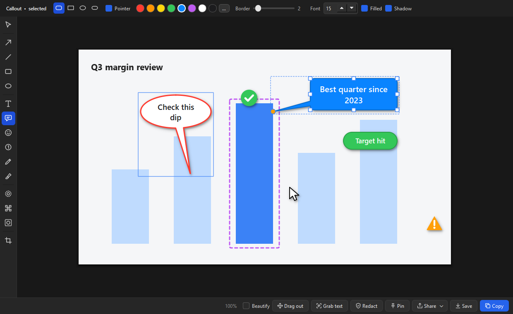

# SnipForge

Free, open-source screenshot and markup tool for Windows: a lightweight alternative to SnagIt.
Press **Win+Shift+S** (or Print Screen), drag over anything, and the snip opens straight in an
editor with arrows, callouts, stamps, blur and more.



## Install

1. **[Download SnipForge for Windows](https://github.com/nighthawk909/snipforge/releases/latest/download/SnipForge-setup.exe)** (this link always gets the newest version).
2. Open `SnipForge-setup.exe`. If Windows shows "Windows protected your PC", choose
   **More info → Run anyway** (the installer isn't code-signed yet). It installs just for you
   (no admin rights) and adds Start menu and desktop shortcuts. Tick **Start SnipForge when I sign
   in** so Win+Shift+S always works.
3. To pin it to the taskbar: open Start, right-click **SnipForge**, choose **Pin to taskbar**.
   (Windows doesn't let apps pin themselves.)

Each [release](https://github.com/nighthawk909/snipforge/releases) lists SHA-256 checksums so you
can verify the download, and has a portable zip if you'd rather not install anything. Setting it up
for a team, a SharePoint or network-share mirror, or Software Center? See
[docs/DISTRIBUTION.md](docs/DISTRIBUTION.md).

## What it does

**Snip.** Win+Shift+S or Print Screen freezes the screen. Hover to highlight a window and click to
take it, drag for a region, or press Enter for the whole monitor. A magnifier shows exact pixels.
The snip is also copied to the clipboard, just like the built-in Snipping Tool.

**Mark up.** Every snip opens in the editor, and everything you add stays editable:

| Tool | Key | |
|---|---|---|
| Select / move | V | click anything to select it with any tool; drag selected items to move them |
| Arrow, line | A, L | Shift snaps to 45° |
| Rectangle, ellipse | R, E | outline or filled, solid or dashed |
| Text | T | plain or on a colored background |
| Callout | K | text in a bubble, box, ellipse or pill, with a pointer you can aim |
| Stamp | I | check, cross, warning, info, star, thumbs up, mouse pointer and more |
| Step number | N | 1, 2, 3… badges for how-to guides |
| Pen, highlighter | P, H | |
| Blur, pixelate | B, X | hide sensitive details |
| Spotlight | S | dim everything except one area |
| Crop | C | drag edges in to cut, back out to restore; Enter applies |

Undo/redo, duplicate (Ctrl+D), nudge with arrow keys, zoom with Ctrl+wheel.

**Share.** Copy (Ctrl+C), save (Ctrl+S), or use **Share**: a new Outlook email with the snip inline,
open a Teams chat with the people you pick, get a OneDrive link, or the Windows share sheet.
**Drag out** drops the image straight into Teams, Outlook, PowerPoint or a folder.

**Extras.** Grab text (OCR, offline) · Redact (finds emails and phone/card numbers and blurs them) ·
Pin a snip on top of other windows · Beautify (backdrop, rounded corners, shadow) · a library of
every snip in `Pictures\SnipForge\Library` that you can reopen and keep editing.

## Privacy

Everything stays on your PC. SnipForge has no accounts, telemetry or analytics, and makes no network
requests except a once-a-day check for new versions on GitHub (you can turn it off in the tray menu) and the **Share** actions you choose. When an update is available, SnipForge asks first, then downloads, verifies and installs it for you. See [docs/IT-REVIEW.md](docs/IT-REVIEW.md)
for a full security and IT review guide.

## Build from source

Requires Windows 10/11 and Python 3.11+.

```bash
pip install -r requirements-dev.txt
python -m snipforge                 # run from source
python -m pytest                    # tests
python scripts/build.py --installer # SnipForge.exe, portable zip and installer (needs Inno Setup 6)
```

To run your organization's own copy (for example on GitHub Enterprise), see
[docs/PORTING.md](docs/PORTING.md).

## Contributing

Bug reports and ideas are welcome in [Issues](https://github.com/nighthawk909/snipforge/issues).
See [CONTRIBUTING.md](CONTRIBUTING.md) for how changes, tests and releases work.

## License

[MIT](LICENSE). Bundled third-party components are listed in [THIRD_PARTY_NOTICES.md](THIRD_PARTY_NOTICES.md).
