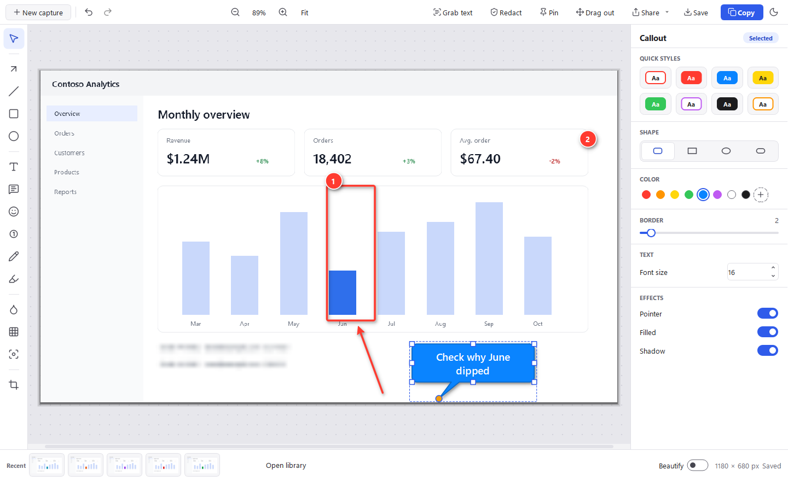
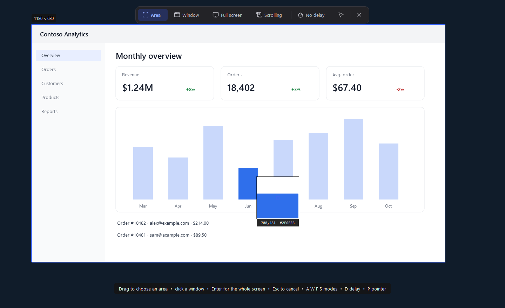
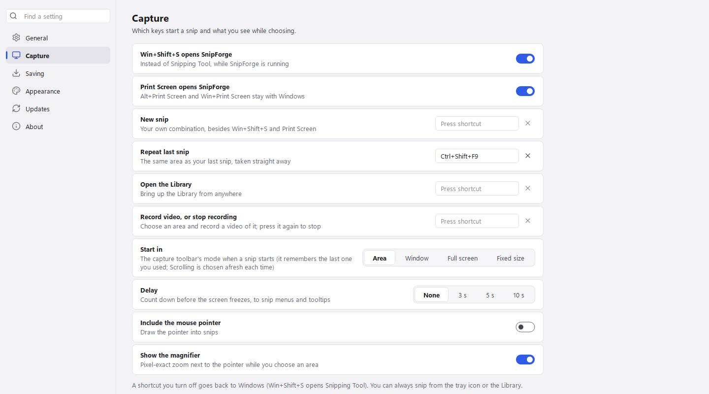
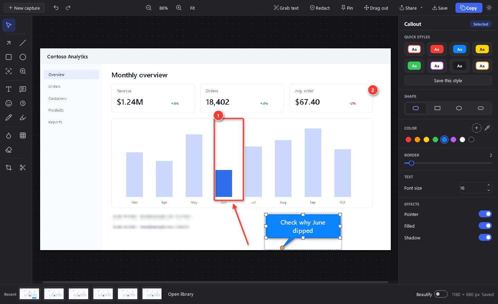
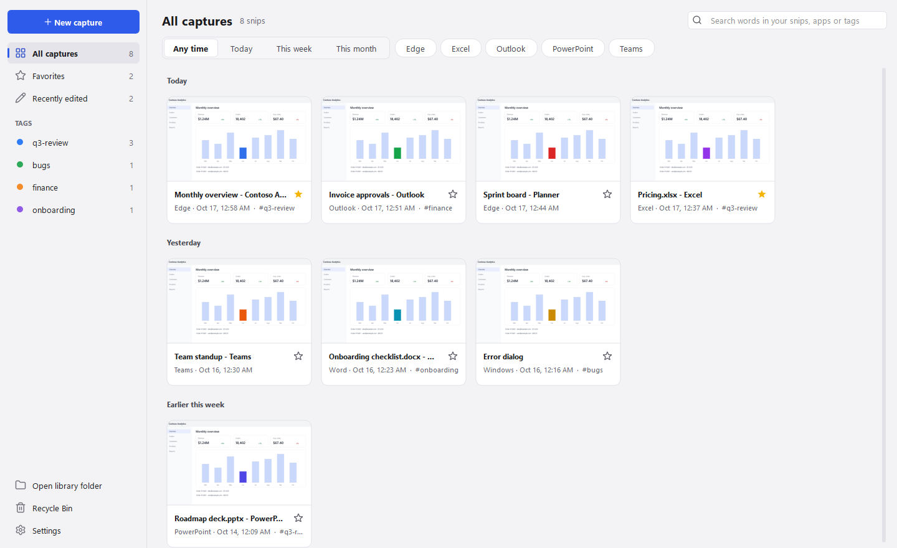
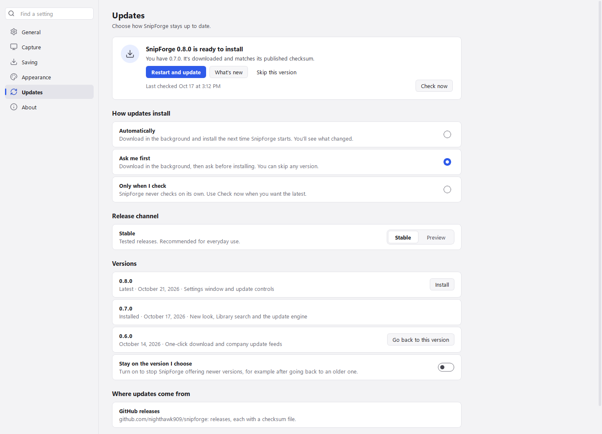
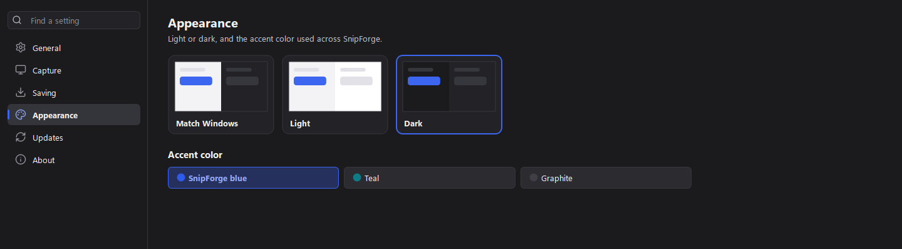

# SnipForge

Free, open-source screenshot and markup tool for Windows: a lightweight alternative to SnagIt.
Press **Win+Shift+S** (or Print Screen), drag over anything, and the snip opens straight in an
editor with arrows, callouts, stamps, blur and more.



## Install

1. **[Download SnipForge for Windows](https://github.com/nighthawk909/snipforge/releases/latest/download/SnipForge-setup.exe)** (this link always gets the newest version).
2. Open `SnipForge-setup.exe`. If Windows shows "Windows protected your PC", choose
   **More info → Run anyway** (the installer isn't code-signed yet). It installs just for you
   (no admin rights) and adds Start menu and desktop shortcuts. Tick **Start SnipForge when I sign
   in** so Win+Shift+S always works.
3. To pin it to the taskbar: open Start, right-click **SnipForge**, choose **Pin to taskbar**.
   (Windows doesn't let apps pin themselves.)

Each [release](https://github.com/nighthawk909/snipforge/releases) lists SHA-256 checksums so you
can verify the download, and has a portable zip if you'd rather not install anything. Setting it up
for a team, a SharePoint or network-share mirror, or Software Center? See
[docs/DISTRIBUTION.md](docs/DISTRIBUTION.md).

## What it does

**Snip.** Win+Shift+S or Print Screen freezes the screen, with a capture toolbar at the top:
**Area** (drag an area, or hover a window and click to take it), **Window**, **Full screen**,
**Fixed size** (a frame of an exact size, like 1280 × 720 or one you type, follows the pointer;
click to snip it) or **Scrolling** (SnipForge scrolls a long page or list to the end and stitches it
into one image), or press Enter for the whole monitor. A magnifier shows exact pixels, and the next snip starts in the
mode you used last. **Delay** counts down 3, 5 or 10 seconds first, so you can open the menu or
tooltip you want to snip, and **Include the mouse pointer** draws the pointer into the snip.
**Repeat last snip** (in the tray menu) takes the same area again, straight away. The snip is also
copied to the clipboard, just like the built-in Snipping Tool. Either key can be handed back to
Windows in Settings, and you can add **shortcuts of your own** there for New snip, Repeat last snip
and the Library.

**Mark up.** Every snip opens in the editor: tools on the left, the snip in the middle, and a
properties panel on the right with **quick styles**, colors, sizes and effects for whatever you've
selected. **Save this style** keeps the selected markup's look as one of your own quick styles for
that tool (right-click one to delete it). The **eyedropper** beside the colors picks any color from
the snip, with a magnified view of the pixels under the pointer. Everything you add stays editable:

| Tool | Key | |
|---|---|---|
| Select / move | V | click anything to select it with any tool; drag selected items to move them |
| Arrow, line | A, L | Shift snaps to 45° |
| Rectangle, ellipse | R, E | outline or filled, solid or dashed |
| Text | T | plain or on a colored background |
| Callout | K | text in a bubble, box, ellipse or pill, with a pointer you can aim |
| Stamp | I | check, cross, warning, info, star, thumbs up, mouse pointer and more, or **App name and date**: text saying which app or window the snip came from and when |
| Step number | N | 1, 2, 3… badges for how-to guides |
| Pen, highlighter | P, H | |
| Blur, pixelate | B, X | hide sensitive details |
| Spotlight | S | dim everything except one area |
| Magnify | M | a circle or box lens showing part of the snip enlarged; move and resize the lens and what it shows |
| Crop | C | drag edges in to cut, back out to restore; Enter applies |
| Cut out | U | drag across a vertical or horizontal strip to take it out and join the rest, with a straight or torn seam |

Undo/redo, duplicate (Ctrl+D), nudge with arrow keys, zoom with Ctrl+wheel.

**Edit the snip itself.** With the Select tool, the panel's **Image** section turns the snip left or
right (Ctrl+Shift+R, Ctrl+R), flips it, and resizes it by pixels or percent with the aspect ratio
kept. Your markup follows: shapes and blurs turn with the image, while text, callouts and stamps
move with it and stay upright. Each change is one undo step, and the original capture is never
lost, so resizing down and back up gives you the original pixels. The **Edges** section adds a
border and tears the sides you pick; torn parts are transparent in a PNG, and Beautify's backdrop
shows through them.

**Share.** Copy (Ctrl+C), save (Ctrl+S), or use **Share**: a new Outlook email with the snip inline,
open a Teams chat with the people you pick, get a OneDrive link, or the Windows share sheet.
**Drag out** drops the image straight into Teams, Outlook, PowerPoint or a folder.

**Find it again.** The **Library** keeps every snip, grouped by day, with the app and window it came
from. Search finds the words *inside* your snips (read offline with Windows' built-in OCR), as
well as titles, apps and tags. Star favorites, tag snips, and filter by time or app. Reopen any
snip and keep editing.

**Make it yours.** Light and dark themes that follow Windows, accent colors, and organization theme
packs ([docs/THEMES.md](docs/THEMES.md)). **Settings** covers startup, shortcuts, the save folder
and format, and updates.

**Stays up to date.** Choose how updates install (automatically, ask me first, or only when I
check), try the Preview channel, install any version or go back to an older one, and stay on the
version you choose. IT can manage all of it by policy and point SnipForge at a company update
location ([docs/IT-REVIEW.md](docs/IT-REVIEW.md)).

**Extras.** Grab text (OCR, offline) · Redact (finds emails and phone/card numbers and blurs them) ·
Pin a snip on top of other windows · Beautify (backdrop, rounded corners, shadow).

## Screenshots

| | |
|---|---|
|  |  |
| **Capture.** Area, Window, Full screen, Fixed size or Scrolling, a delay, and the mouse pointer, with a magnifier for exact pixels. | **Settings > Capture.** Which keys start a snip, shortcuts of your own, and how each snip starts: mode, delay and the pointer. |
|  |  |
| **Editor, dark.** Tools on the left, quick styles and properties on the right, recent snips along the bottom. | **Library.** Every snip by day, searchable by the words inside it, with favorites, tags and app filters. |
|  |  |
| **Settings > Updates.** Choose how updates install, the release channel, any version (or go back to one), and stay on the version you choose. | **Settings > Appearance.** Match Windows, light or dark, and the accent color. |

Screenshots are rendered from the app with sample content: `QT_QPA_PLATFORM=windows python scripts/make_screenshots.py`.

## Privacy

Everything stays on your PC. SnipForge has no accounts, telemetry or analytics, and makes no network
requests except the update checks and downloads you choose in **Settings > Updates** (once a day by
default, or only when you click Check now) and the **Share** actions you use. Every update is
verified against its published checksum before it installs. Text recognition for Library search
runs offline. See [docs/IT-REVIEW.md](docs/IT-REVIEW.md) for a full security and IT review guide.

## Build from source

Requires Windows 10/11 and Python 3.11+.

```bash
pip install -r requirements-dev.txt
python -m snipforge                 # run from source
python -m pytest                    # tests
python scripts/build.py --installer # SnipForge.exe, portable zip and installer (needs Inno Setup 6)
```

To run your organization's own copy (for example on GitHub Enterprise), see
[docs/PORTING.md](docs/PORTING.md).

A Mac version is on the way: [docs/MAC-PLAN.md](docs/MAC-PLAN.md) has what works on macOS today,
how to build the test `.dmg`, and what's left.

## Contributing

Bug reports and ideas are welcome in [Issues](https://github.com/nighthawk909/snipforge/issues).
See [CONTRIBUTING.md](CONTRIBUTING.md) for how changes, tests and releases work.

## License

[MIT](LICENSE). Bundled third-party components are listed in [THIRD_PARTY_NOTICES.md](THIRD_PARTY_NOTICES.md).
